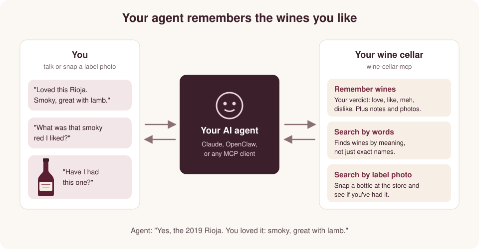

# Wine Cellar MCP: a wine memory for your AI agent



An MCP server that lets an AI agent remember which wines you like. Tell your
agent about a wine, or send it a photo of the label, and it records the wine
with your verdict and notes. Later, ask "have I had this, and did I like it?"
and it searches by text, by photo, or both.

Any agent that speaks MCP over Streamable HTTP can use it. Claude Code and
NemoClaw (OpenClaw) are covered below as examples.

## What your agent can do

- **Remember wines.** Save a wine with your verdict, tasting notes, and label
  photos, and update it later.
- **Search by words.** Ask in your own words, like "that smoky red I liked",
  and it finds wines by meaning, not just exact names.
- **Search by label photo.** Send a photo of a bottle and it tells you whether
  you've had it and what you thought.

Under the hood, these are the tools your agent sees:

| Tool | What it does |
| --- | --- |
| `create_wine` | Record a wine and your opinion (only the name is required) |
| `update_wine` | Change a wine, e.g. a new verdict or more notes |
| `search_wines` | Search by text, a label photo, or both |
| `list_wines` | List with filters (verdict, varietal, created/updated dates), paged with `next_token` |
| `get_wine` | One wine |
| `delete_wine` | Remove a wine |
| `add_photo` | Get a link to upload a label photo to a wine |
| `delete_photo` | Remove a photo from a wine |
| `upload_search_photo` | Get a link to upload a photo to search with |

A wine has a name (free text from the label), an optional vintage and
varietal, a verdict (`love`, `like`, `meh`, `dislike`), notes, and photos.
Search photos are deleted after the search and never saved.

No tool takes a user ID: your token decides whose wines a request touches, so
an agent can't read or change anyone else's.

## What you need

- The server URL, e.g. `https://mcp.wine.example.com/mcp`.
- Your API token (starts with `wct_`). It decides whose wines your agent
  reads and writes, so keep it private and give each person their own. Ask
  whoever runs the service for one.

Any MCP client works if it speaks Streamable HTTP and can send an
`Authorization: Bearer <token>` header. Photo uploads go straight to S3
through pre-signed links, so the agent also needs network access to S3 and a
way to upload a file (e.g. `curl`).

## Connect your agent

### Claude Code

Add the server in local scope, which keeps the token in `~/.claude.json` and
out of your repo. Don't use `-s project`; that writes the token to
`.mcp.json`.

```
claude mcp add --transport http wine https://<server-domain>/mcp \
  --header "Authorization: Bearer $(cat ~/.config/wine-cellar/token)"
claude mcp get wine
```

Start a new `claude` session in the same folder and talk to it normally; it
picks the tools from their descriptions.

### NemoClaw (OpenClaw)

NemoClaw supports remote MCP servers over HTTPS with Streamable HTTP and puts
the token in the `Authorization` header. The raw token stays in OpenShell's
provider store; the agent config holds only a placeholder:

```
export WINE_MCP_TOKEN=<your-token>
nemoclaw <sandbox> mcp add wine --url https://<server-domain>/mcp --env WINE_MCP_TOKEN
unset WINE_MCP_TOKEN
```

NemoClaw rejects URLs with query strings, so the token can only go in the
header. Its 131,072-byte cap on MCP request bodies doesn't affect photos,
since they upload straight to S3, but the sandbox needs egress to the S3
endpoint for those uploads.

## Learn more

- How it works: [docs/DESIGN.md](docs/DESIGN.md)
- Running your own deployment: [docs/DEPLOY.md](docs/DEPLOY.md)

## Contributing

Working on the service itself? See [CONTRIBUTING.md](CONTRIBUTING.md).
